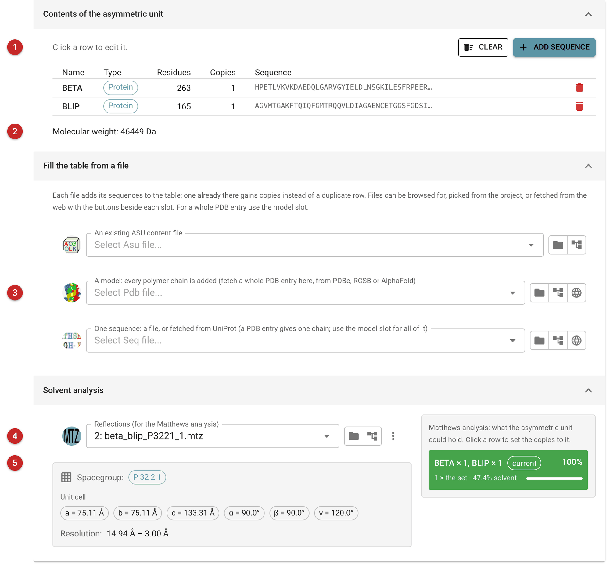
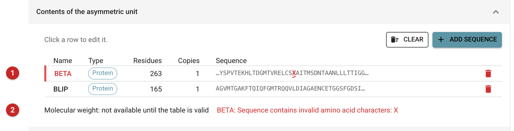
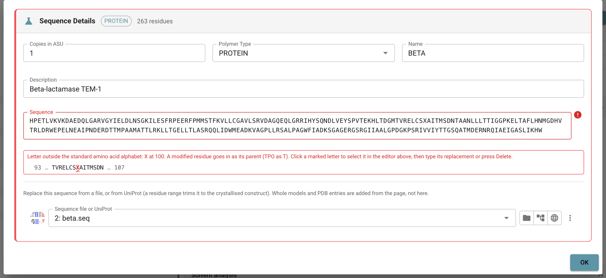
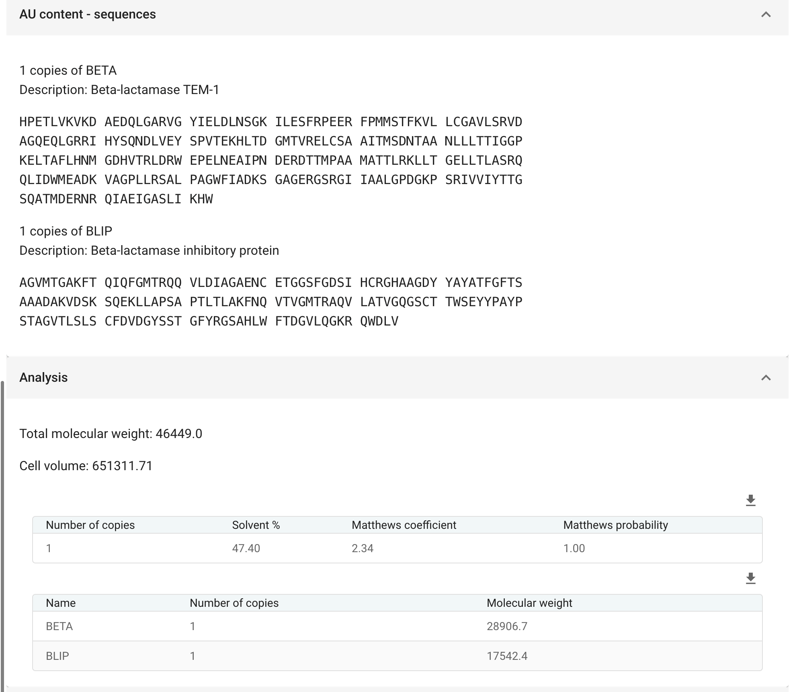

##################
Define AU contents
##################

   This task records what the asymmetric unit is expected to hold: each
   protein, DNA or RNA sequence and how many copies of it. The result, an
   *AU contents* file (``.asu.xml``), is what later tasks read when they
   need to know the composition: molecular replacement for the scattering
   content, density modification for the solvent content, model building
   for what to build. You can also use the task to edit existing AU
   contents: load them, change them and save a new version.

   The number of copies matters. Tasks estimate the solvent content from
   the whole contents, so the wrong number of copies gives the wrong
   solvent content. If you are not sure, give the task the reflection data
   and let the Matthews analysis choose, or choose from it yourself.

   The pictures on this page come from the demo data that ships with
   CCP4i2: the beta-lactamase / BLIP complex, one copy of each.

Input
=====

   |input|

   The table **(1)** is the contents: one row per distinct sequence, with
   its name, polymer type, length and number of copies. Click a row to
   edit it; *Add sequence* adds an empty row to fill in; *Clear* empties
   the table. Two chains with the same sequence belong in one row with
   two copies, not in two rows. The molecular weight of the whole
   contents is shown below the table **(2)**, once every row is valid.

   The quickest way to fill the table is from a file. A model **(3)**
   adds every polymer chain it holds, identical chains as copies of one
   row; a PDB entry fetched into this slot, from PDBe, RCSB or AlphaFold,
   gives the whole entry at once. A sequence file, or a UniProt entry
   fetched into the sequence slot, adds one sequence. An existing AU
   contents file adds its entries. A sequence already in the table gains
   copies rather than a second row. A modified residue in a model, such
   as a phosphorylated threonine or selenomethionine, is recorded as its
   parent (T, M); glycans, ions and terminal caps are not sequence and
   are left out.

   In a row's editor, give the number of copies in the asymmetric unit,
   the polymer type, a name and, optionally, a description. Paste the
   sequence, or replace it from a sequence file or a UniProt accession (a
   residue range trims it to the crystallised construct). Spaces and line
   breaks are ignored.

   Give the reflection data **(4)** and the task works out, from the cell
   and space group, how many copies of the table's contents the
   asymmetric unit could hold, with the solvent content and Matthews
   probability of each **(5)**. Each row of the analysis spells out what
   it would mean for every entry (here *BETA × 1, BLIP × 1*); the row that
   matches the table as it stands is marked *current* and the most
   probable *best guess*. Click a row to set the table's copies to it,
   keeping their ratios (a table of 2 A + 1 B set to the row *2 ×*
   becomes 4 A + 2 B). When a model or sequence file fills the table, or
   the reflections change, the best guess is applied for you until you
   pick a row. Here one copy of the complex leaves 47.4% solvent, the
   only possibility: two copies would leave none.

   The Matthews probability is a prior over known crystals, not evidence
   about yours. It favours around 50% solvent, so a genuinely open crystal
   with 60% solvent can rank below a tighter packing that is wrong. A
   model fetched from the PDB already tells you the copies; if the best
   guess disagrees with what you know, click the row you know to be
   right.

Sequences the task cannot use
=============================

   |problem|

   Every letter must be one of the twenty standard amino acids, or C, A,
   U, G, T for a nucleic acid. Any other letter, including X for an
   unknown residue, blocks the task: it usually means a comment, a
   modified-residue code or a selenocysteine (U) has crept in. The row
   with the problem is marked, its sequence preview is centred on the
   offending letter **(1)**, and the message under the table names the
   entry **(2)**.

   |editor|

   Open the row and the editor shows, in the red box beneath the
   sequence, a numbered excerpt around each rejected letter: here residue
   100 of beta-lactamase, with the seven residues either side. Click the
   marked letter to select it in the sequence above, then type the
   letter that belongs there or press Delete.

Results
=======

   |report|

   The report lists each sequence with its number of copies and, if the
   reflection data were given, the Matthews analysis: for each possible
   number of copies of the contents, the solvent content, the Matthews
   coefficient and its probability, with the molecular weights and the
   cell volume they were calculated from. Here the complex of 46449 Da in
   a cell of 651312 Å\ :sup:`3` gives a Matthews coefficient of 2.34
   Å\ :sup:`3`/Da for one copy.

